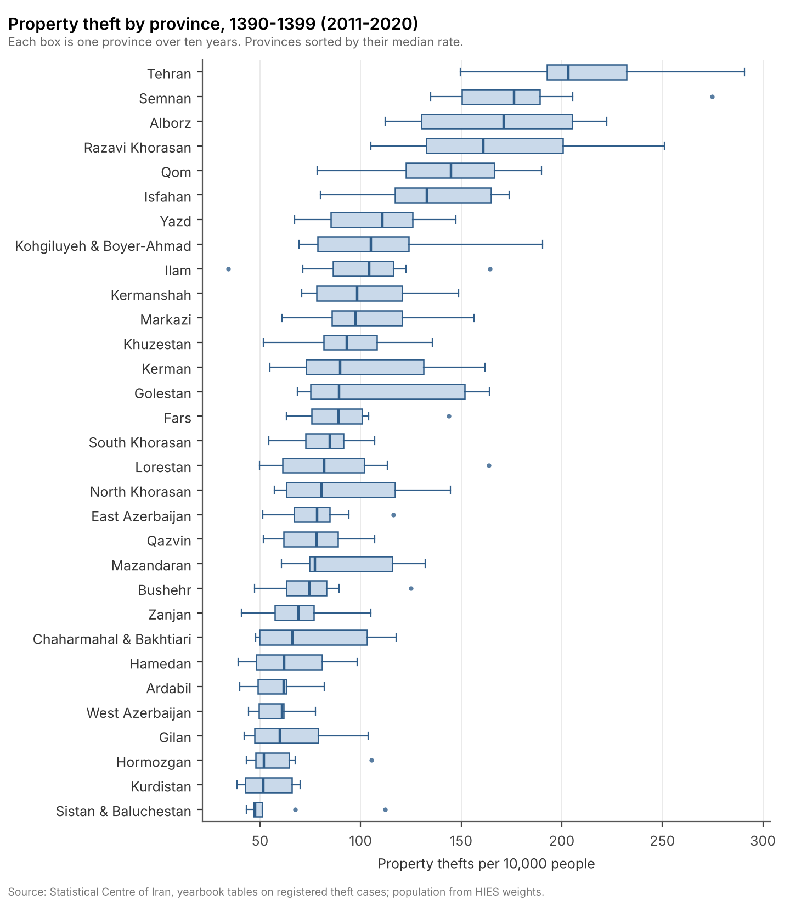
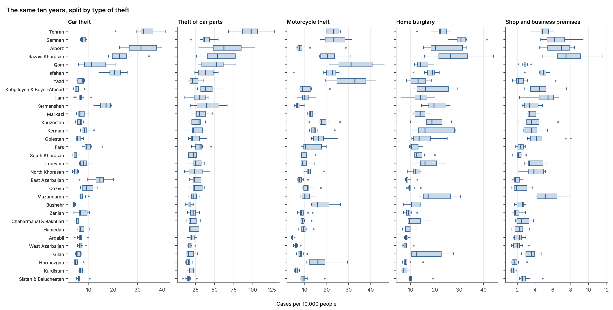

# Poverty and property theft in Iran's provinces

Course project for Social Economics at Sharif University of Technology (spring 2024).

The question was simple: when a province has more poor people, does it also have more property theft? Becker's economics of crime says it should, at least at the margin, because legal income is worth less when you are poor. I wanted to see if this shows up in Iranian provincial data for the 1390s (2011-2020).

## Data

Two sources from the Statistical Centre of Iran (SCI), put together into a panel of **31 provinces x 10 years = 310 observations**:

- **Theft.** Registered theft cases by province, typed in from the SCI statistical yearbooks. Total property theft is the sum of all theft categories (cars, car parts, motorcycles, homes, shops, livestock, public and private premises, and others).
- **Poverty and household characteristics.** The Household Income and Expenditure Survey (HIES). I used the national expenditure deciles to measure poverty: the share of a province's population that falls in the poorest decile (and, as alternatives, the poorest two and three deciles). The same survey gives the controls: literacy, number of earners, household size and unemployed household heads.

The raw files are not in this repository. See [`data/README.md`](data/README.md) for what is needed and where it comes from.

## What the data look like

Theft rates differ a lot across provinces, much more than they move within a province over the decade. Tehran, Semnan, Alborz and Razavi Khorasan sit at the top; Sistan & Baluchestan, Kurdistan and Hormozgan at the bottom.



The ranking is not the same for every type of theft. Car theft is concentrated in Tehran and Alborz, motorcycle theft is high in Qom, Yazd and Semnan, and home burglary is highest in Semnan and Razavi Khorasan.



One thing I kept in mind while reading these numbers: they are *registered* cases. In poorer provinces stolen goods are often worth less, and people may not bother to report them, so low recorded theft in a poor province can partly be a reporting effect.

## Model

$$
\text{Theft}_{it} = \beta\,\text{PoorShare}_{it} + X_{it}'\gamma + \alpha_i + \varepsilon_{it}
$$

$\text{Theft}_{it}$ is property theft per 10,000 people in province $i$ and year $t$, $\text{PoorShare}_{it}$ is the share of the population in the poorest decile(s), $X_{it}$ are the household controls and $\alpha_i$ are province fixed effects. The fixed effects matter here: they take out everything about a province that does not change over ten years, so the coefficient comes only from changes within a province.

## Results

From the original report (province fixed effects):

| | (1) | (2) | (3) | (4) |
|---|---|---|---|---|
| Share in poorest decile | 16.85 (67.20) | 26.15 (66.43) | | |
| Share in poorest two deciles | | | -13.69 (36.49) | |
| Share in poorest three deciles | | | | -22.34 (26.71) |
| Earners per household member | | 27.34*** (8.15) | 17.39** (8.06) | 15.56* (8.12) |
| Controls | No | Yes | Yes | Yes |
| Observations | 310 | 310 | 310 | 310 |

Standard errors in parentheses. \*\*\* p<0.01, \*\* p<0.05, \* p<0.1. Other controls (literacy, household size, unemployed head) are not significant.

The short answer is **no clear relationship**. None of the poverty shares is close to significant, and the sign flips once the two or three poorest deciles are used. The only variable that holds up is the number of earners per household member, and it has the "wrong" sign: more earners, more theft. My reading is that this says more about the demand side of the crime market (more income means more things worth stealing, as in Ehrlich's model) than about who commits the thefts, but reverse causality and omitted variables are both real concerns here.

There are also good reasons to doubt the poverty measure itself. National deciles ignore that the same budget means different things in Tehran and in a small town, and the share in the bottom decile says nothing about how deep poverty is. With only ten years per province there is also not much within-province variation to work with.

## About the code

I wrote the first version during the course and it was messy: copied blocks for each year, province names matched by row number, and covariates taken from a single household row instead of province averages. For this repository I rewrote it into three short do-files. The new version builds every province-year variable as a weighted average, clusters standard errors by province and adds a specification with year effects.

Because of these changes, running the new code will not give exactly the numbers in the table above, which come from the 2024 report.

```
code/
  master.do                    run everything in order (set ROOT at the top)
  01_hies_province_panel.do    HIES summary files -> province-year panel
  02_crime_panel.do            yearbook theft tables -> province-year panel
  03_analysis.do               merge, figures, fixed-effects regressions
figures/                       figures used in this README
```

Requires Stata 17 and `estout` (`ssc install estout`). The figures in this README were redrawn from the charts of the original report.

## References

- Becker, G. S. (1968). Crime and punishment: An economic approach. *Journal of Political Economy*, 76(2), 169-217.
- Ehrlich, I. (1996). Crime, punishment, and the market for offenses. *Journal of Economic Perspectives*, 10(1), 43-67.
- Keshavarz Haddad, G., & Markazi Moghadam, H. (2014). The socioeconomic and demographic determinants of crime in Iran (a regional panel study). *Journal of Economic Studies*, 41(1), 20-34.
- Kelly, M. (2000). Inequality and crime. *Review of Economics and Statistics*, 82(4), 530-539.
